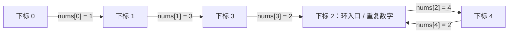

# 287. Find the Duplicate Number：从数组跳转到快慢指针

题目：[寻找重复数](https://leetcode.cn/problems/find-the-duplicate-number/)

代码：[0287_find_the_duplicate_number.py](../two_pointers/0287_find_the_duplicate_number.py)

## 1. 先读出题目真正提供的条件

- 数组长度为 `n + 1`，下标范围为 `0～n`。
- 所有元素的值都在 `1～n`。
- 只有一种数字重复，但它可以出现两次以上。
- 必须保持输入数组不变，只使用 `O(1)` 额外空间。

`n + 1` 个位置只能填写 `n` 种数字，根据抽屉原理，至少有一种数字重复。
这里不保证 `1～n` 的每种数字都出现：例如 `[3, 3, 3, 3, 3]` 也符合条件。

原来的双重循环会对每个位置重新扫描右侧，最坏比较次数为：

```text
n + (n - 1) + ... + 1 = n(n + 1) / 2
```

实际代码找到重复数会提前返回，但最坏仍是 `O(n²)`，例如两个相等元素位于数组末尾。
当规模接近 `10⁵` 时，比较次数可以接近 50 亿次。

## 2. 这个算法是怎样联想到的

最有用的线索是数值范围：**每个 `nums[i]` 都可以当作一个合法下标。**

于是可以把数组解释为一张跳转表：当前位置是 `i`，下一步到 `nums[i]`。

```python
i = nums[i]
```

这与链表有相同的移动方式：

| 链表中的含义 | 数组中的对应关系 |
| --- | --- |
| 当前节点 | 当前下标 `i` |
| 下一个节点 `node.next` | 下一个下标 `nums[i]` |
| 沿着 next 移动 | 执行 `i = nums[i]` |

这只是使用数组已有的跳转关系，不需要创建链表、节点或额外数组。

例如：

```python
# 下标： 0  1  2  3  4
nums = [1, 3, 4, 2, 2]
```

从下标 `0` 出发，得到：

```text
0 → 1 → 3 → 2 → 4 → 2 → 4 → ...
```



每个位置的下一步是固定的，而且始终是合法下标，所以可以不断前进。
位置数量有限，最终必然重新到达已经访问过的位置；之后的路径会循环重复。

## 3. 为什么从 0 出发，为什么环入口是答案

数组中没有数值 `0`，因此没有任何节点指向 `0`，起点 `0` 一定在环外。
沿着这条路径第一次进入环的节点，叫作环入口。

设入口编号为 `v`。它有两个不同的前驱：

1. 环外路径的最后一个节点 `u`，满足 `nums[u] == v`。
2. 环内绕一圈回到入口的节点 `w`，满足 `nums[w] == v`。

`u` 在环外，`w` 在环内，所以 `u != w`。两个不同下标都存着 `v`，说明 `v` 是重复数字。
题目保证只有一种数字重复，因此这个入口编号就是答案。

在示例中，`nums[3] == 2` 和 `nums[4] == 2`，分别提供了从环外进入和从环内返回的两条边。
所以入口编号 `2` 是重复数字；重复的两个元素实际位于下标 `3` 和 `4`。

固定从 `0` 出发很重要。任意选择起点时，可能直接落在环内，失去“环外进入入口”的条件。
例如从本例的下标 `4` 出发，路径是 `4 → 2 → 4`，不能直接把这个起点当作重复数。

## 4. 第一阶段：让快慢指针在环内相遇

两个指针保存的都是“当前下标”。慢指针每轮走一步，快指针每轮走两步：

```python
slow = nums[slow]
fast = nums[nums[fast]]
```

例如 `fast == 0` 时，两步分别是 `0 → nums[0] == 1`、`1 → nums[1] == 3`，所以更新后 `fast == 3`。

两个指针都从 `0` 出发，需要先移动，再判断是否相遇。初始的 `slow == fast == 0` 不是环内相遇。

| 轮次 | slow：走一步 | fast：走两步 | 状态 |
| --- | --- | --- | --- |
| 初始 | 0 | 0 | 起点，尚未移动 |
| 1 | 1 | 3 | 继续 |
| 2 | 3 | 4 | 继续 |
| 3 | 2 | 4 | 继续 |
| 4 | 4 | 4 | 第一次在环内相遇 |

进入环后，快指针每轮相对慢指针多前进一步，二者在环上的相对位置会不断变化，最终一定相遇。
本例的相遇点是 `4`，而重复数字是 `2`，因此第一阶段结束时还不能直接返回。

## 5. 第二阶段：回到起点，两个指针同速前进

把 `slow` 放回 `0`，让 `fast` 留在相遇点。之后两者都每轮走一步：

```python
slow = 0
while slow != fast:
    slow = nums[slow]
    fast = nums[fast]
```

| 轮次 | slow | fast |
| --- | --- | --- |
| 复位后 | 0 | 4 |
| 1 | 1 | 2 |
| 2 | 3 | 4 |
| 3 | 2 | 2 |

两条路径是：

```text
slow：0 → 1 → 3 → 2
fast：4 → 2 → 4 → 2
```

再次相遇的位置 `2` 就是环入口。

## 6. 为什么第二次相遇一定在入口

定义三个距离：

- `a`：起点 `0` 到环入口的步数。
- `L`：环长。
- `t`：第一阶段相遇时，慢指针总共走过的步数。

快指针走了 `2t` 步。相遇时，两者位于环内的同一个节点，快指针多走的路程必定是整数个环长：

```text
2t - t = kL
     t = kL
```

所以 `t` 是环长的整数倍。

第二阶段，把留在相遇点的指针再向前移动 `a` 步。它的路径可以理解为：先从起点走 `t` 步到相遇点，
然后再走 `a` 步，总共相当于从起点走 `t + a` 步。

其中，进入环前消耗了 `a` 步，进入环后剩下的步数为：

```text
(t + a) - a = t = kL
```

它在环内正好走了整数圈，因此停在环入口。
与此同时，另一个从 `0` 出发的指针走了 `a` 步，也正好到达入口。

在走满 `a` 步之前，起点出发的指针仍在环外，另一个指针始终在环内，二者不可能提前相遇。
因此第二阶段的首次相遇位置一定就是环入口。

本例中 `a = 3`、`L = 2`、`t = 4`，满足 `t = 2L`。
从相遇点 `4` 再走 3 步，就是 `4 → 2 → 4 → 2`，与起点出发的指针同时到达入口 `2`。

## 7. 完整代码

```python
class Solution:
    def findDuplicate(self, nums: list[int]) -> int:
        slow = fast = 0

        # 第一阶段：找到环内相遇点。
        while True:
            slow = nums[slow]
            fast = nums[nums[fast]]
            if slow == fast:
                break

        # 第二阶段：找到环入口。
        slow = 0
        while slow != fast:
            slow = nums[slow]
            fast = nums[fast]

        return slow
```

## 8. 复杂度与题目限制

设可达路径的环外长度为 `a`、环长为 `L`。第一阶段只需 `O(a + L)` 步，第二阶段走 `a` 步；
可达节点数不超过数组长度，因此两个阶段合计为 `O(n)` 时间。

两段循环依次执行，不是嵌套执行，时间复杂度不相乘。
代码只保存两个整数指针，没有创建集合、计数表、链表或数组副本，额外空间为 `O(1)`。
两阶段都只读取 `nums`，没有对数组元素赋值，输入保持不变。

| 方法 | 时间 | 额外空间 | 是否满足本题限制 |
| --- | --- | --- | --- |
| 两两比较 | 最坏 O(n²) | O(1) | 保持输入，但大规模时容易超时 |
| 集合记录已见数字 | 平均 O(n) | O(n) | 不满足常量空间要求 |
| Python 原地排序后比较相邻值 | 最坏 O(n log n) | 最坏 O(n) | 修改输入，也不满足常量空间要求 |
| 快慢指针找环入口 | O(n) | O(1) | 满足 |

## 9. 易错点与检查用例

- `slow` 和 `fast` 存的是下标，`nums[slow]` 是下一步的下标。
- 使用本文的 `0/0` 起步方式时，第一阶段必须先移动再比较，不能直接写 `while slow != fast`。
- 第一阶段相遇点不一定是答案；需要第二阶段再找入口。
- 第二阶段只把一个指针放回 `0`，另一个保留在相遇点，并且两者都改为每次走一步。
- 返回 `slow` 本身，因为入口编号就是重复的数值。返回 `nums[slow]` 会再跳到下一个位置。
- 重复数字可以出现三次或更多次，不能假设数组由完整的 `1～n` 加上一个额外数字构成。
- 题目保证有重复数且所有跳转合法，因此这里不需要处理空数组或寻找 `None` 终点。

| 输入 | 答案 | 检查重点 |
| --- | --- | --- |
| `[1, 3, 4, 2, 2]` | 2 | 相遇点 4 与入口 2 不同 |
| `[3, 1, 3, 4, 2]` | 3 | 值与下标的跳转关系 |
| `[3, 3, 3, 3, 3]` | 3 | 同一数字重复多次、环为自环 |
| `[1, 1]` | 1 | 最小合法长度 |
| `[2, 1, 2]` | 2 | 从 0 直接进入自环，其他位置可能存在无关的环 |
| `[1, 2, 3, 4, 5, 5]` | 5 | 较长环外路径与自环 |
| `[2, 3, 4, 5, 1, 2]` | 2 | 环外路径只有一步，环包含其余全部节点 |

## 10. 怎样把这个思路迁移到其他题

遇到数值范围恰好对应合法下标的数组题，可以先尝试画出 `i → nums[i]` 的关系。
如果每个位置的下一步固定，就可以检查是否存在重复访问、环或汇合点，再判断这些结构与题目答案有什么联系。
仍然要证明对应关系；不能只凭“数组里有重复数字”就直接套用环入口算法。

本题依次完成了三个转换：

```text
值能作为下标 → 数组提供固定跳转路径 → 从 0 出发的环入口就是重复数字
```

可以结合已有的 [142. 环形链表 II](../linked_list/0142_linked_list_cycle_ii.py) 复习：
142 通过节点的 `next` 移动，本题通过数组的 `nums[i]` 移动，后面的找环入口过程相同。
